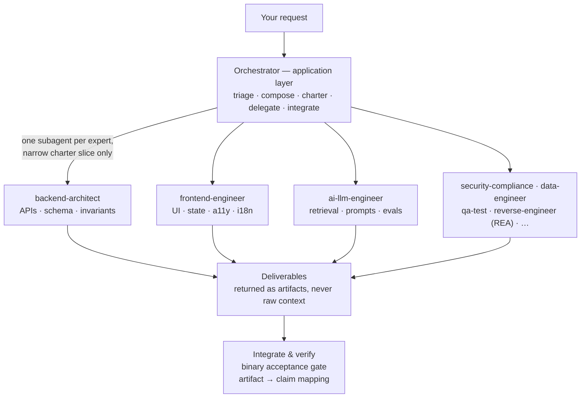
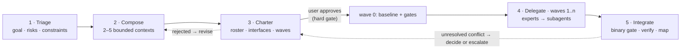

# Mixture Team of Experts (MTOE)

A coding-agent skill that turns a request into a **team of domain-specific experts**
and orchestrates them — instead of handing everything to one general-purpose agent.



- **Experts are bounded contexts.** Each one owns a domain, speaks its own language,
  and refuses what is outside it (DDD × agent-oriented software engineering —
  [*Agents for DDD – Back and Forth*, EMAS 2024](https://dl.acm.org/doi/10.1007/978-3-031-71152-7_11)).
- **Composition beats one big general agent.** Narrow context is the permission
  boundary; specialists fail in one place, parallelize cleanly, and cost fewer
  tokens ([*Domain-Specific AI Agents: Why Composition Beats One Big General
  Agent*](https://ospeks.com/domain-specific-ai-agents-composition-vs-general-agent/)).
- **Structure follows [mattpocock/skills](https://github.com/mattpocock/skills)**:
  one user-invoked orchestrator, a library of model-invoked expert archetypes, plain
  markdown you can hack on, and a `to-tickets` companion for the ticket track.
- **Verification-first (high-trust).** The trust pyramid is inverted: deterministic
  code constraints (lint rules, AST analyzers, type bans) outrank prose; experts
  execute their changes in a runtime/sandbox and return **verification artifacts** —
  test-runner outputs, CLI feature-map traces, property-based UI test logs,
  statechart visualizations — not text summaries. Justification prose never lifts
  a ban: violations fail and escalate. Acceptance is a **binary gate** — not a
  weighted score — on the execution proof.

## Install

```bash
# project-level (editable files copied into your project)
npx skills add https://github.com/SilentJMA/mixture-team-of-experts --skill mtoe

# or user-level, available in every project
npx skills add https://github.com/SilentJMA/mixture-team-of-experts --skill mtoe -g

# target a specific agent non-interactively
npx skills add https://github.com/SilentJMA/mixture-team-of-experts --skill mtoe -a claude-code
```

The CLI's canonical store is `.agents/skills/mtoe` (project) or
`~/.agents/skills/mtoe` (global), wired into each agent's skill directory (e.g.
`.claude/skills/`, `.opencode/skill/`). **Manual install:** copy `skills/mtoe/` into
your agent's skill directory — e.g. `~/.agents/skills/mtoe` (global) or
`<project>/.claude/skills/mtoe` (per-project). No dependencies beyond the markdown
files; companions are optional and detected at preflight.

**Editing after install:** installed files are plain markdown and meant to be hacked
on — tune an archetype, delete experts, author new ones from `_TEMPLATE.md`. One
honest caveat: `npx skills update` re-installs from source and **will overwrite local
edits** — fork the repo or skip updates for customized installs.

## Use

Invoke `/mtoe` (or just say *"put a team of experts on this"*) with your request:

```
/mtoe add OAuth login to our app — Google + GitHub, sessions, and an admin audit trail
```

The orchestrator then runs the five phases:



1. **Triage** — goal, deliverable type, risk domains, constraints; deterministic-
   constraint sweep (read-only); capability & companion preflight; asks up to 3
   questions if vague.
2. **Compose** — the smallest team (2–5 experts) that covers the risk domains; each
   expert gets a bounded context. A **coherence reviewer** (`product-strategist`)
   handles scope/priority when the deliverable spans domains; integration stays
   with the orchestrator.
3. **Charter** — a `docs/teams/<YYYY-MM-DD>-<topic>/charter.md` (roster, interfaces,
   ticket track, deterministic constraints, verification plan, write ownership,
   execution waves, environment/capabilities, integration & acceptance, approval).
   **You approve it before anything spawns.**
4. **Delegate** — wave 0 (baseline + constraint gates + gate self-test), then
   delegation waves. One subagent per expert, each seeing only its archetype + charter
   slice; independent experts run in parallel; every change is executed in a
   runtime/sandbox and returned with verification artifacts. Discloses degraded
   sequential mode if subagents are unavailable.
5. **Integrate** — **binary acceptance gate** per deliverable (shape + all checks
   pass + re-runs reproduce + no unwaived violations + writes in owned set; any
   failure → one corrective round). Conflicts resolved by the orchestrator; unresolved
   → escalate with both options. Final verification at merged HEAD.

## The roster

| Archetype | Bounded context |
|---|---|
| `product-strategist` | Scope, priorities, acceptance criteria (the coherence reviewer) |
| `backend-architect` | API contracts, data model, invariants, concurrency |
| `frontend-engineer` | UI, state, accessibility, i18n/RTL, responsiveness |
| `ai-llm-engineer` | Retrieval, embeddings, rerank, prompts, evals |
| `devops-sre` | Deployment, CI/CD, observability, runbooks |
| `security-compliance` | Threat models, findings, data-protection requirements |
| `reverse-engineer` | Feature archaeology of a target app, without source |
| `data-engineer` | Ingestion, sync/watermarks, dedup, migrations |
| `qa-test-engineer` | Test strategy, seams, fixtures, regression nets |

Add your own: copy `experts/_TEMPLATE.md` and fill in the six sections (now seven,
including the ticket & acceptance contract). Tune or delete experts by editing the
files — nothing regenerates or overwrites your edits.

## Ticket track

Every run is logged, traced, and marked like a real team:

- **Parent ticket** (`01-<topic>.md` locally, or issue #1 on a real tracker) — the
  request itself; status `proposed` → `in-progress` → `complete`.
- **One ticket per expert deliverable** — numbered in dependency order (blockers
  first), each with `Blocked by` edges derived from the charter's dependency graph.
- **Blocking edges** — ticket N is blocked by every ticket whose deliverable N
  consumes, plus the parent.
- **Status transitions** — `proposed` (charter written) → `in-progress` (spawned)
  → `complete` (binary gate passed) | `blocked` (factual blocker). Written against the
  to-tickets template (tracer-bullet slices, checkbox acceptance criteria, no stale
  file paths).
- **Local vs real tracker** — local: one file per ticket under
  `docs/teams/<YYYY-MM-DD>-<topic>/tickets/01-<topic>.md`; real: one issue per ticket
  via the `to-tickets` companion, `ready-for-agent` triage label, native blocking
  links where available.

Full design: [`docs/specs/2026-11-15-mtoe-design.md`](docs/specs/2026-11-15-mtoe-design.md).

## Companion skills

When installed, MTOE routes specialized work through them — only via the
accountable expert, as an explicit Skill-tool call (one skill per call), to
model-invoked companions only:

- **[cloudflare/security-audit-skill](https://github.com/cloudflare/security-audit-skill)** —
  the `security-compliance` expert runs explicit audit requests through its
  six-phase, adversarially-validated workflow (`confirmed` / `needs_validation` /
  `rejected` findings). Security *questions* stay in guidance mode. Output is pinned
  into the run's artifact folder; the OS-sandbox limitation is surfaced honestly.
- **[morluto/rea](https://github.com/morluto/rea)** — when you ask to *analyze a
  similar app to implement a similar feature*, the `reverse-engineer` expert uses
  REA's MCP tools to inspect the target and returns evidence-backed findings as a
  handoff artifact for the implementing experts.

- **[mattpocock/skills — to-tickets](https://github.com/mattpocock/skills/blob/main/skills/engineering/to-tickets/SKILL.md)** —
  the ticket track for every run: tracer-bullet tickets, blocking edges, status
  updates, published to the configured tracker (or written locally).

Missing companions degrade gracefully: the expert does a bounded review itself and
flags the gap.

## Design sources

1. *Agents for DDD – Back and Forth* (Ricci, Burattini, Ciortea, Castellucci — EMAS 2024) — bounded contexts as agents; application/domain layer split.
2. *Domain-Specific AI Agents: Why Composition Beats One Big General Agent* (ospeks.com) — the four-layer agent anatomy; scope as permission boundary.
3. [mattpocock/skills](https://github.com/mattpocock/skills) — user-invoked vs model-invoked skill structure; `to-tickets` for the ticket track.
4. [mattpocock/skills — to-tickets](https://github.com/mattpocock/skills/blob/main/skills/engineering/to-tickets/SKILL.md) — tracer-bullet tickets, blocking edges, published to the configured tracker.

Full design: [`docs/specs/2026-11-15-mtoe-design.md`](docs/specs/2026-11-15-mtoe-design.md).

## License

MIT.
