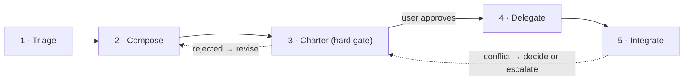

# Mixture Team of Experts (MTOE) — Skill Design

Date: 2026-11-15
Status: Approved for implementation

## Goal

**Mixture Team of Experts (MTOE)** — the name nods to Mixture-of-Experts: instead of one dense general agent, a router composes a small team of specialized experts per request. A user-invoked agent skill (`/mtoe`) that analyzes any user request and turns it into a **composed team of domain-specific experts**, where each expert is a narrowly scoped sub-agent and a single orchestrator delegates, coordinates, and integrates their work — instead of handing the whole request to one general-purpose agent.

## Motivation and sources

Three sources ground the design:

1. **"Agents for DDD – Back and Forth"** (Ricci, Ciortea, Burattini, Castellucci — EMAS 2024).
   Domain-Driven Design and Agent-Oriented Software Engineering integrate in two ways that matter here:
   - **Bounded contexts can be modeled as agents.** Each expert in this skill is a bounded context: it owns a domain, speaks a ubiquitous language, and has an explicit boundary of what it does *not* handle.
   - **Application layer vs domain layer.** The orchestrator is the application layer (coordination, sequencing, integration); the experts are the domain layer (they know their domain deeply and nothing else). Experts exchange **artifacts** (deliverables), not raw internal context.

2. **"Domain-Specific AI Agents: Why Composition Beats One Big General Agent"** (ospeks.com).
   - One agent wired to every tool and document fragments attention and fails everywhere at once; composed specialists fail in exactly one place.
   - The anatomy of a domain-specific agent has **four layers**: (1) model + system prompt defining role *and* what it refuses, (2) a tool/context layer scoped so narrowly that **the scope is the permission boundary**, (3) hooks/state, (4) an isolated sandbox.
   - Delegation is just another entry in the tool layer; some agents are **leaves** and never delegate. Narrow agents are cheaper (token efficiency) and parallelize cleanly.

3. **mattpocock/skills** (structure reference).
   - Skills split into **user-invoked** (orchestration, reachable only when typed) and **model-invoked** (reusable discipline, auto-reachable when the task fits). A user-invoked skill may invoke model-invoked ones, never another user-invoked one.
   - Small, composable, hackable markdown files — no framework to own you.

## Scope

### In scope (v1)

- One user-invoked orchestrator skill `SKILL.md` (invoked as `/mtoe`).
- A library of **expert archetypes** (markdown files) covering the core engineering domains.
- The five-phase orchestration loop: Triage → Compose → Charter → Delegate → Integrate.
- Delegation via the harness's `subagent` facility, one subagent per expert.
- A **team charter** document as the deterministic, user-approved artifact of the composition step.
- Composability: after charter approval, the orchestrator may hand implementation work to existing skills (`writing-plans`, `subagent-driven-development`, `tdd`, `code-review`).
- **Companion-skill routing**: specific experts route deep, specialized work to two installed companion skills — Cloudflare's `security-audit` skill for codebase security audits, and REA (`reverse-engineer-anything`) for reverse-engineering a similar application to implement a similar feature.

### Out of scope (v1)

- Enforced tool-level sandboxing or native agent configs (Approach B/C — possible later).
- Code/scripts that parse requests or generate agent configs.
- Long-term memory or cross-session expert state.
- Automatic re-spawning or supervision loops beyond one round of follow-up per expert.

## Skill structure

The repository follows the standard `skills.sh` layout — a `skills/` directory whose subfolder is the installable unit — so any agent can install it with a one-line command (see *Installation and distribution*):

```
team-of-experts/                     # repository root (GitHub: mixture-team-of-experts)
├── README.md                        # purpose, install, usage, theory links
├── docs/
│   └── specs/                       # this document
└── skills/
    └── mtoe/             # the installable skill
        ├── SKILL.md                 # user-invoked orchestrator (/mtoe)
        └── experts/                 # model-invoked archetypes (the roster library)
            ├── _TEMPLATE.md         # canonical shape for authoring new experts
            ├── product-strategist.md
            ├── backend-architect.md
            ├── frontend-engineer.md
            ├── ai-llm-engineer.md
            ├── devops-sre.md
            ├── security-compliance.md
            ├── reverse-engineer.md
            ├── data-engineer.md
            └── qa-test-engineer.md
```

The archetype library is the editable "team roster": users add, remove, or tune experts by editing markdown files. Nothing else needs to change.

`SKILL.md` must resolve its `experts/` directory **relative to its own file location** at run time, so the skill behaves identically whether it was installed globally, per-project, or copied by hand.

## Orchestrator flow (SKILL.md)



### Phase 1 — Triage

Analyze the request to extract:

- **Goal**: what outcome the user wants.
- **Deliverable type**: design/analysis, implementation, review, migration, research, ops change.
- **Risk domains**: which bounded contexts the request touches (e.g. auth → security; UI → frontend; schema → backend + data).
- **Constraints**: stack, deadlines, compliance posture.

If the request is ambiguous, ask the user up to **three** clarifying questions (multiple choice preferred). Do not compose a team from a vague request.

### Phase 2 — Compose

Select the smallest team that covers the risk domains: **2–5 experts by default**. Never spawn a specialist for a domain the request does not touch. Always include exactly one **integrating expert** for multi-expert teams when the deliverable spans domains (default: `product-strategist`, acting as the founder/lead voice).

For each selected expert, record its bounded context:

| Field | Meaning |
|---|---|
| **Owns** | Decisions and artifacts this expert is accountable for |
| **Does not own** | Explicit refusals — the boundary (e.g. frontend expert does not design DB schema) |
| **Language** | Ubiquitous terms this domain uses, so the charter speaks one language |
| **Deliverables** | Artifact shapes it returns |
| **Depends on** | Which expert's deliverables it consumes |

### Phase 3 — Charter (hard gate)

Write the charter to `docs/teams/YYYY-MM-DD-<topic>-charter.md` in the current working repository by default, or to any path the user names:

```md
# Team Charter: <request title>
## Roster
| Expert | Bounded context | Owns | Explicitly not | Deliverables |
## Interfaces
<who hands what artifact to whom, in what format>
## Execution plan
<wave 1: parallel experts with no dependencies; wave 2: dependents; …>
## Integration & verification
<how deliverables merge; what checks run before reporting done>
```

**The user must approve the charter before any expert spawns.** This is the skill's control point: the user sees the whole team, its boundaries, and the plan — and can reshape it cheaply before any work happens.

### Phase 4 — Delegate

For each expert, spawn one subagent via the harness `subagent` tool:

- **Prompt composition** = the expert's archetype file (role, boundaries, language, quality bar) + the charter slice for that expert (task brief, owns/does-not-own, deliverable spec) + the minimal shared context the task requires. **Nothing else** — narrow context is the point.
- **Parallelism**: experts with no mutual dependencies spawn in the same wave; dependent experts spawn after their dependencies' deliverables exist, receiving only those deliverables (not the whole transcript).
- **Leaves by default**: an expert returns deliverables; it does not spawn sub-subagents unless its archetype explicitly declares a delegation rule.
- **Follow-ups**: at most one clarification round per expert, via the subagent session id.

### Phase 5 — Integrate

The orchestrator (application layer) then:

1. Collects deliverables and checks each against its charter spec.
2. **Resolves boundary conflicts** itself (e.g. backend wants a synchronous API, frontend wants streaming — the orchestrator decides per the charter's integration rules, or escalates to the user). Experts never negotiate with each other directly.
3. Runs verification (checks, builds, tests as applicable — `verification-before-completion` discipline).
4. Reports with a **deliverable → expert mapping**, so the user can trace every artifact to its accountable expert.

## Installation and distribution

Modeled on mattpocock/skills and cloudflare/security-audit-skill: no build step, no plugin host required — the repo *is* the package, and any agent that understands skills can install it.

**One-line install (skills.sh, any supported agent):**

```bash
# project-level (editable files copied into the project)
npx skills add https://github.com/<owner>/mixture-team-of-experts --skill mtoe

# or user-level, available in every project
npx skills add https://github.com/<owner>/mixture-team-of-experts --skill mtoe --global
```

**Manual install (no tooling):** copy `skills/mtoe/` into the agent's skill directory — e.g. `~/.agents/skills/mtoe` (global) or `<project>/.claude/skills/mtoe` / `.opencode/skill/` (project-level). The skill has zero dependencies beyond the markdown files.

**Editing after install:** installed files are plain markdown and meant to be hacked on — tune an archetype, delete experts you don't need, or author new ones from `_TEMPLATE.md`. Nothing regenerates or overwrites them.

The README documents all three paths and links the source material.

## Expert archetype shape

Each file in `experts/` follows the ospeks four-layer anatomy expressed as markdown:

```md
---
name: <kebab-case-expert-name>
description: <one line + trigger phrases; this is how the orchestrator matches it>
delegates: false        # true only if this expert may spawn its own sub-subagents
---
# Role & life objective
<What this expert optimizes for. Specific enough to say what it refuses.>
# Boundaries
<Explicit "does NOT touch" list — the permission boundary in prose.>
# Ubiquitous language
<Terms this domain owns, with one-line definitions.>
# Context contract
<What context it may request; what it must not read.>
# Deliverables
<Artifact shapes it returns, with acceptance criteria.>
# Quality bar
<Checks it must run before returning (builds, tests, lint, self-review).>
```

## Companion skill integrations

Two installed companion skills are treated as domain tooling. **Only the orchestrator routes to them, and only through the accountable expert** — an expert may invoke a model-invoked companion skill as part of its own workflow, never a user-invoked skill.

### Security audits → Cloudflare `security-audit` skill

Source: https://github.com/cloudflare/security-audit-skill

- **Trigger**: a charter row for the `security-compliance` expert requires a codebase security audit, vulnerability review, or pen test.
- **Routing**: the expert produces that deliverable **through** the companion skill's six-phase workflow (reconnaissance → coverage-led hunting → candidate validation → structured output → independent record verification → target-neutral reporting), inheriting its machine-readable findings (`findings.json` verdicts: `confirmed` / `needs_validation` / `rejected`) and its design principles — adversarial validation (the checker is never the finder), severity requires impact, and defense-in-depth gaps are hardening notes, not vulnerabilities.
- **Mode discipline**: explicit audit/pen-test requests run full audit mode; security *questions* and focused reviews stay in guidance mode. The orchestrator never silently escalates to full audit mode.

### "Build a feature like app X" → REA (`reverse-engineer-anything`)

Source: https://github.com/morluto/rea

- **Trigger**: the user asks to analyze a similar project or application in order to implement a similar feature — the "see a feature you like, understand how it works, build a version for my project" pattern.
- **Routing**: compose a **`reverse-engineer` expert** (new archetype) whose job is *feature archaeology*: use REA's MCP tools to inspect the target (application behavior, JavaScript/Electron, native binaries, websites, captures) and return **evidence-backed findings** — how the feature works, with the evidence and limitations behind each conclusion. Those findings become a **handoff artifact** consumed by the implementing experts (backend, frontend, ai-llm), who build the version for the user's project. The reverse-engineer expert does not implement.
- **Boundaries**: only targets the user owns or is authorized to examine (REA's responsible-use position: lawful analysis of your own or authorized software). Findings must cite evidence; unverified conclusions are reported as limitations, not facts. If REA is unavailable for a target type, the expert says so instead of guessing.

## Failure handling

| Failure | Response |
|---|---|
| Ambiguous request | Up to 3 clarifying questions in Triage; if still unclear, stop and ask. |
| No archetype fits a needed domain | Tell the user; offer to author a new archetype from `_TEMPLATE.md` first. |
| Expert deliverable misses its spec | One corrective follow-up; if still off, orchestrator does the work itself and marks the gap in the report. |
| Boundary conflict between deliverables | Orchestrator decides using the charter; unresolved conflicts escalate to the user with both options stated. |
| User rejects charter | Revise composition (add/remove/shrink team) and re-present; nothing spawns until approved. |
| Companion skill not installed | The accountable expert falls back to its own bounded review and states the gap in its deliverable; the orchestrator notes the missing companion in the report. |

## Verification

The skill itself is verified by use:

1. A dry run on a sample request (e.g. "add OAuth login to our app") produces a charter with 2–4 experts, correct boundaries, and a sensible execution plan.
2. A delegation round produces one deliverable per expert, each traceable to its charter row.
3. The final report maps every deliverable to an expert and every expert to a bounded context.
4. Routing checks: a "security audit" charter row routes through the `security-compliance` expert to the Cloudflare `security-audit` skill's phase workflow; an "analyze app X and build a similar feature" request composes the `reverse-engineer` expert, whose findings artifact feeds the implementing experts.
5. Install checks: `npx skills add <repo-url> --skill mtoe` completes against a fresh checkout, and a manually copied skill folder resolves its `experts/` directory correctly (archetype loading works from a relative path).
6. `README.md` links to all source documents (DDD paper, composition article, mattpocock/skills, security-audit-skill, REA) and explains how to add a new expert archetype.

## Later extensions

- **Approach B (optional)**: generate harness-native agent configs from the charter for enforced tool scoping.
- **Approach C (optional)**: pin frequent teams as native specialist agents for zero-composition latency.
- **Roster growth**: archetypes for research, writing, legal/privacy review, etc. — additive only, per the archetype template.
